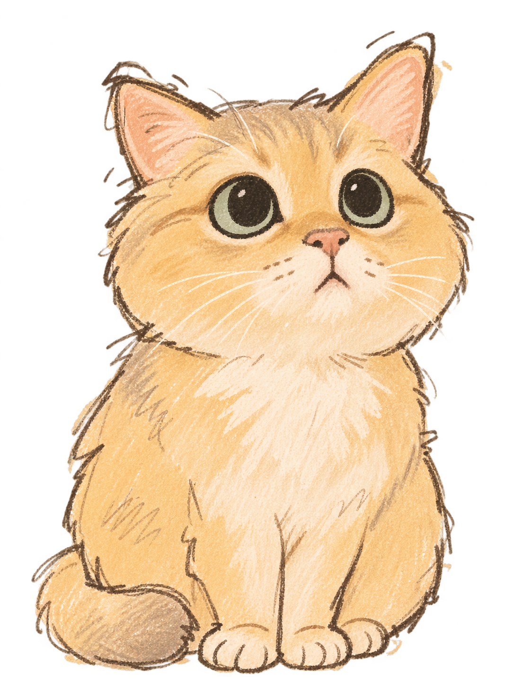

# kurocat-customeowze

**把自家猫画成桌宠，在 AI 聊天里继续改。** 名字化用 customize，把自定义小猫的 “meow” 放进去。

这是 [qianyiai/kurocat](https://github.com/qianyiai/kurocat) 的非官方 Fork，基于上游 v5.1.0。保留原版键鼠桌宠和参数定制，新增通过 MCP 导入自由绘制素材的能力。

[English](README.en.md) · [使用说明](docs/DIY.md) · [给 AI 的安装说明](docs/INSTALL.md) · [MIT](LICENSE)

> **实验性源码版，无本分支安装包。** 已在 Apple Silicon Mac 上完成构建与测试；Windows / Linux 的新增能力尚未实机验证。WorkBuddy、Manus、豆包等客户端尚未逐一联调。原版安装包不包含这里的新功能。

## 看看画风

<p align="center"></p>

金渐层仅作为示例，不是固定角色或默认毛色。默认提示词采用松散蜡笔、断线重描、略怪诞的手绘风；每只猫的毛色、花纹、耳形和神态来自自己的照片。也可以导入其他画风，只要满足动作部件布局。

## 比原版多了什么

- **自由绘制外观**：从原模型改色、加斑点，扩展到自定义脸型、轮廓、身材和笔触。
- **继续在 AI 聊天里改**：MCP 工具可导入素材、改名称、微调头身爪比例和裁切位置、更换画稿、查看及导出。
- **外观更新，动作保留**：2D 素材沿用键盘、鼠标、眨眼等动作，同一只猫更新后自动刷新。
- **皮肤包分享**：导出 `.catpack`，朋友导入后直接使用同一套素材，不必重新生成。
- **保留原版参数工具**：快速改色仍可使用 `get_cat_schema` / `upsert_cat`。
- **体验修正**：点击呼噜声的音频预热与起音优化；关闭上游应用内更新入口，避免定制版被原版覆盖。

不增加独立工坊窗口，不在应用里保存图像服务密钥。图片由 AI 客户端的图像工具或外部生成工具提供，费用遵循对应服务规则。

## 两个概念，直白一点

**素材规范**就是告诉 AI “这只猫要怎么拆开才能动”：一张透明 PNG，分成睁眼头、闭眼头、身体、尾巴和两只前爪。`get_custom_skin_guide` 会返回完整提示词和布局要求，用户不用自己填坐标。生成后 `import_custom_skin` 从本机文件导入；布局不对时可以调整裁切或重新生成。

**独立皮肤包**就是“做好的小猫成品文件”。`.catpack` 包含绘制后的 PNG 和动作设置，不含原始参考照片、API 密钥或脚本。让 AI 导出发给朋友，朋友再让 AI 导入。只有这个文件不能独立运行，仍需要安装此分支并连接 MCP。

## 在 AI 聊天里怎么用

1. 安装此分支并把它的 MCP 接入支持本地工具的 AI 客户端，见 [安装说明](docs/INSTALL.md)。
2. 发猫咪照片，让 AI 先调用 `get_custom_skin_guide`，再使用它自己的图像工具制作素材。
3. 素材保存到运行桌宠的电脑后，调用 `import_custom_skin` 导入并显示。
4. “头小一点”可以直接调比例；“眼神再呆一点”需要 AI 重画素材并调用 `update_custom_skin`。
5. 满意后通过 `export_custom_skin` 导出，分享给朋友。

支持 MCP 与支持图片生成是两项能力。若客户端只能连接远程服务，不能直接访问这台电脑，就还需要本地连接方式或文件传输步骤。参见 [完整说明与限制](docs/DIY.md)。

## 让 Agent 安装这个分支

把下面这段和仓库链接一起发给你的 Agent：

> 请安装 https://github.com/RockyYang1225/kurocat-customeowze 的默认分支。先读 README.md、AGENTS.md 和 docs/INSTALL.md。这是源码版，请检查编译环境、从这个仓库构建，并连接新增的自定义素材 MCP 工具。不要下载原版 KuroCat 的安装包来代替。如果已有 KuroCat，请先保护已有设置和小猫。

仅报项目名不保证 Agent 找对仓库，也不代表已经有包管理器的一键安装命令。

## 本机开发（macOS）

需要 Git、Node.js 22.18+（推荐 24 LTS）、npm、Rust stable/Cargo 和 Xcode Command Line Tools。其他平台还需要 Tauri 的对应系统依赖。

```sh
git clone https://github.com/RockyYang1225/kurocat-customeowze.git
cd kurocat-customeowze
npm ci
npm run build
npm run tauri:dev
```

构建可独立运行的桌面程序，但暂不制作安装包：

```sh
npm run tauri -- build --no-bundle
```

可执行文件内部名称暂沿用 `KuroCat`。MCP 配置与现有应用数据目录的兼容关系见 [安装说明](docs/INSTALL.md)，不要直接覆盖已有应用或同时运行上游版和本分支。

## 验证

```sh
node --test tests/audio-latency.test.mjs tests/diy-skin.test.mjs
npm run build
cargo test --manifest-path src-tauri/Cargo.toml --lib --release
cargo build --manifest-path src-tauri/Cargo.toml --release --bin KuroCat
KUROCAT_TEST_BINARY=src-tauri/target/release/KuroCat node --test tests/mcp-custom-skins.test.mjs
```

目前通过 32 项 Rust 测试与 7 项 Node 测试（包含真实编译程序的 Stdio MCP 全流程），以及浏览器中同编号素材刷新检查。测试采用临时数据目录，不访问付费图像服务。系统级权限、不同客户端和其他操作系统仍需分别验证。

## 来源与许可

原项目：[qianyiai/kurocat](https://github.com/qianyiai/kurocat)。感谢原作者和贡献者。本仓库保留原项目历史、[MIT 许可证](LICENSE)及第三方素材声明。新增功能由此 Fork 独立维护，不代表原项目官方版本。

原版鲸鱼娘素材的 MIT 声明见 [src/assets/dafeiyu/LICENSE-MIT.txt](src/assets/dafeiyu/LICENSE-MIT.txt)。原项目首页存档见 [README.upstream.md](README.upstream.md)，其中下载链接和功能描述属于上游项目。
